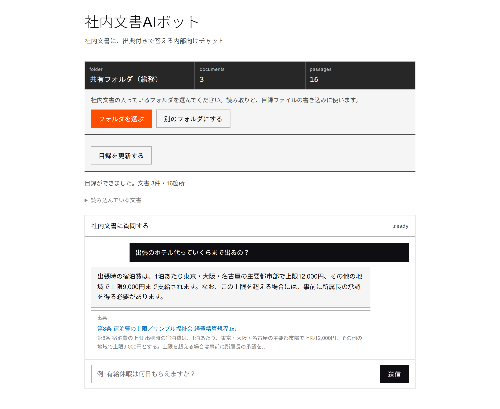

# rag-bot

[](https://github.com/Mxhlix/rag-bot/actions/workflows/test.yml)

English | [日本語](#日本語)

A chatbot that reads your internal documents and answers employee questions with citations.
When the documents do not contain the answer, it does not guess. It replies "not found" instead.



## Two setups

| | Single-file HTML version | Server version |
|---|---|---|
| Location | `app/ragbot.html` (`npm run build` outputs one file to `dist/`) | `app/public/` + `app/functions/` + `app/src/` |
| Runs on | The browser only. No server needed | Cloudflare Pages + Pages Functions |
| Loading documents | The user picks a folder (File System Access API). Supports Word, Excel, PDF and plain text | Documents are converted to text and placed in `src/documents.mjs` |
| Search | Semantic search with Gemini embeddings (`gemini-embedding-001`) | Cloudflare Workers AI embeddings. A lightweight search without embeddings is also included |
| Answer generation | Gemini | Claude Messages API |
| Key property | Documents only travel between the user's PC and the AI service | Everyone can use it through an internal URL protected by a passphrase |

The server version has a demo mode that runs the whole RAG path (ingest, chunk, embed, search, answer with citations) with no API key and no network access. The tests run in this demo mode.

## Accuracy

Five search setups were tried, measuring how many questions each got right: 28 conversational questions, plus 4 questions whose answers are not in the documents (2026-08-04, 12 fictional documents written for this test, 42 answer locations).

- Semantic search alone ranked the correct passage first for all 28 questions. It also declined all 4 unanswerable questions.
- Adding query rewriting or AI re-ranking did not improve the results.
- A search based only on word overlap, without embeddings, ranked the correct passage first for 14 of 28 questions.

The single-file HTML version uses the semantic-search-only setup. The method, full results and limitations are in [bench/README.md](bench/README.md) (Japanese).

## Design notes

- Every answer carries a citation. An answer is not guaranteed to be correct, so it comes with the document name and the article or heading, so a person can check the original text.
- When there is no answer, it stays silent. If search finds no supporting passage, it replies "not found" and attaches no citation.
- It does not hold on to your documents. In the single-file HTML version the documents are read on the user's PC. The only place they are sent is the AI service called with the user's own API key.
- Document contents and answers are not logged. The server version only logs information without content, such as counts and the mode.
- No secrets in the code. The API key and the passphrase are read from environment variables (Cloudflare secrets).
- All output to the page is escaped. HTML inside a document will not run. Security headers are set in `public/_headers`.
- Instructions inside documents are not followed. The prompt for answer generation tells the model to ignore commands written in the documents.

## Getting started

The tests and the demo run on Node.js 18 or later. Building the single-file HTML version needs Node.js 22.13 or later because of pdf.js.

```
cd app
npm install
npm test          # check the acceptance criteria automatically (24 checks)
npm run serve     # open demo mode at http://localhost:8787 (passphrase: demo)
npm run build     # output the single-file HTML version to dist/
```

To use the single-file HTML version, open `dist/ragbot.html` in Google Chrome, enter a Gemini API key, and pick the folder that holds your documents.
Steps to deploy the server version with production settings are in [app/README.md](app/README.md) (Japanese).

## Project layout

```
app/
  ragbot.html        source of the single-file HTML version
  build.mjs          embeds pdf.js and bundles everything into one file
  server.mjs         local server for checking (demo mode)
  public/            server version UI
  functions/api/     server version chat API (Cloudflare Pages Function)
  src/               RAG core (chunking, embedding, search, answer generation, passphrase)
  test/verify.mjs    automated acceptance checks
bench/               measured accuracy for each search setup
docs/                screenshots
```

## Not yet verified

- For the server version's production path (actually calling Claude and Workers AI), the tests only confirm that the code has a hook to swap it in.
- Placing the single-file HTML version in a shared company folder and having several people use it at once has not been tried.
- Testing was done in Google Chrome only.

## License

MIT. See [LICENSE](LICENSE).

---

## 日本語

社内文書を読み込ませ、社員の質問に出典付きで答えるチャットボットです。
文書に答えが無い質問には、無理に答えずに「見つかりません」と返します。


### 2つの構成

| | 単体HTML版 | サーバ版 |
|---|---|---|
| 場所 | `app/ragbot.html`（`npm run build` で `dist/` に1ファイルを出力） | `app/public/` + `app/functions/` + `app/src/` |
| 動く場所 | ブラウザだけ。サーバ不要 | Cloudflare Pages + Pages Functions |
| 文書の読み込み | 利用者がフォルダを選ぶ（File System Access API）。Word・Excel・PDF・テキストに対応 | 文書をテキストにして `src/documents.mjs` に入れる |
| 検索 | Gemini の埋め込み（`gemini-embedding-001`）で意味検索 | Cloudflare Workers AI の埋め込み。埋め込みなしの軽量検索も同梱 |
| 回答生成 | Gemini | Claude Messages API |
| 特徴 | 文書が利用者のPCと AI サービスの間でしか動かない | 合言葉付きの社内URLで全員が使える |

サーバ版には、APIキー無し・通信無しで RAG の全経路（取り込み → 分割 → 埋め込み → 検索 → 出典付き回答）を通すデモモードがあります。テストはこのデモモードで動きます。

### 精度

検索の構成を5通り変えて、口語の質問28問と、答えが文書に無い質問4問で正答率を測りました（2026-08-04、この測定用に書いた架空文書12本42箇所）。

- 意味検索だけで28問すべての正解を1位で拾えました。答えが無い4問もすべて断れました。
- 質問の書き換えや AI による選び直しを足しても、改善はありませんでした。
- 埋め込みを使わない言葉の重なりだけの検索では、1位が正解なのは28問中14問でした。

単体HTML版は、意味検索だけの構成です。測り方・全結果・限界は [bench/README.md](bench/README.md) にあります。

### 設計で気をつけたこと

- **答えには必ず出典を付ける。** 回答の正しさは保証できないので、文書名と条・見出しを添え、人が原文で確かめられる形にしています。
- **答えが無いときは黙る。** 検索で根拠が見つからない質問には「見つかりません」と返し、出典を付けません。
- **文書を預からない。** 単体HTML版では、文書は利用者のPCの中で読まれ、送り先は利用者のAPIキーで呼ぶ AI サービスだけです。
- **文書の中身と回答をログに残さない。** サーバ版のログは件数やモードなど、中身を含まない情報だけです。
- **秘密情報をコードに書かない。** APIキーと合言葉は環境変数（Cloudflare のシークレット）から読みます。
- **画面への出力はすべてエスケープする。** 文書の中にHTMLが入っていても実行されません。セキュリティヘッダは `public/_headers` で付けています。
- **文書の中の指示には従わない。** 回答生成の指示文で、文書に書かれた命令を無視するよう指定しています。

### 動かし方

テストとデモは Node.js 18 以上で動きます。単体HTML版のビルドには、pdf.js の都合で Node.js 22.13 以上が必要です。

```
cd app
npm install
npm test          # 合格条件を自動で確かめる（24項目）
npm run serve     # http://localhost:8787 でデモモードを開く（合言葉は demo）
npm run build     # 単体HTML版を dist/ に出力
```

単体HTML版は、`dist/ragbot.html` を Google Chrome で開き、Gemini の APIキーを入れて、文書の入ったフォルダを選ぶと使えます。
サーバ版を本番の設定で公開する手順は [app/README.md](app/README.md) にあります。

### フォルダ構成

```
app/
  ragbot.html        単体HTML版の原本
  build.mjs          pdf.js を埋め込んで1ファイルにする
  server.mjs         ローカル確認用サーバ（デモモード）
  public/            サーバ版の画面
  functions/api/     サーバ版のチャットAPI（Cloudflare Pages Function）
  src/               RAG の本体（分割・埋め込み・検索・回答生成・合言葉）
  test/verify.mjs    合格条件の自動確認
bench/               検索構成ごとの正答率の実測
docs/                画面写真
```

### まだ確かめていないこと

- サーバ版の本番経路（Claude と Workers AI を実際に呼ぶ構成）は、テストではコード上の差し替え口があることまでしか確かめていません。
- 単体HTML版を社内の共有フォルダに置き、複数人で同時に使う形は試していません。
- 動作確認は Google Chrome だけで行っています。

### ライセンス

MIT です。[LICENSE](LICENSE) を見てください。
